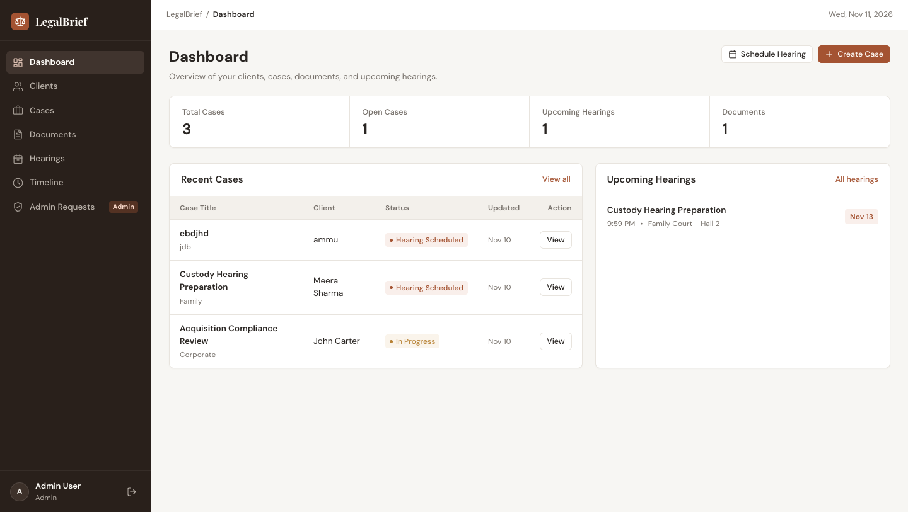
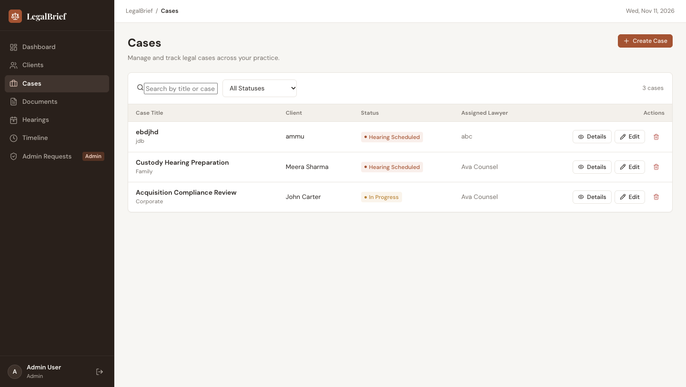
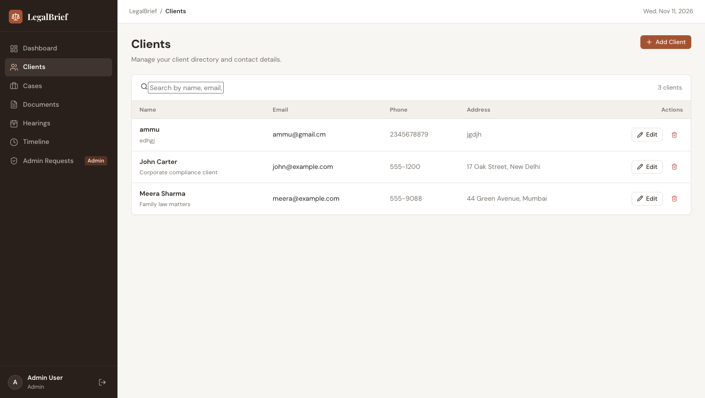
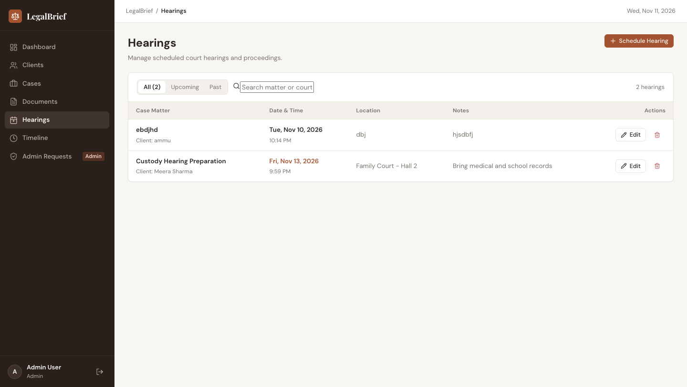
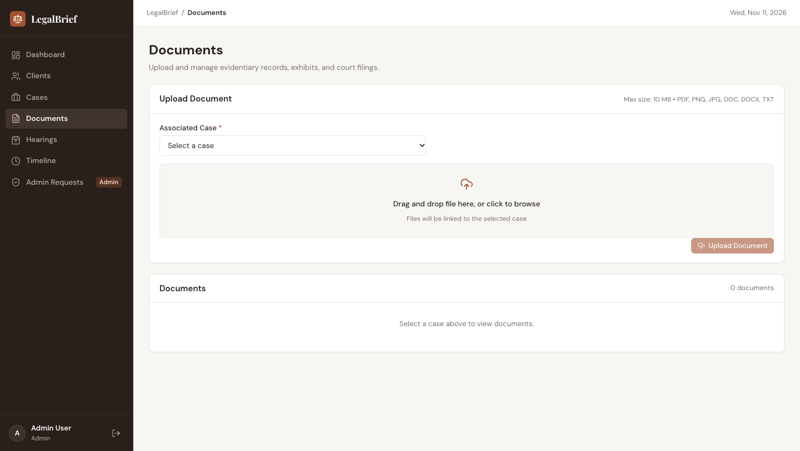
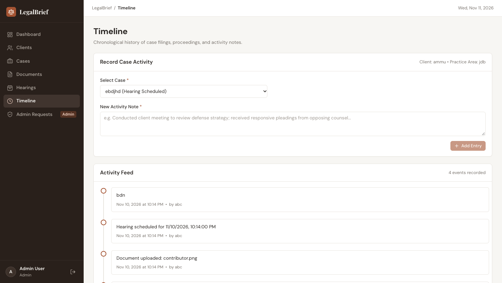
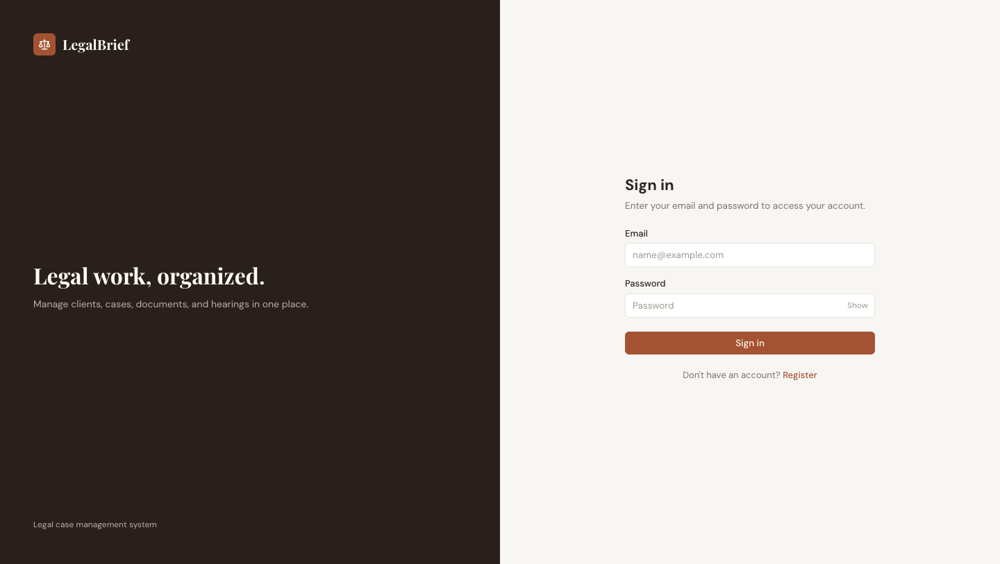
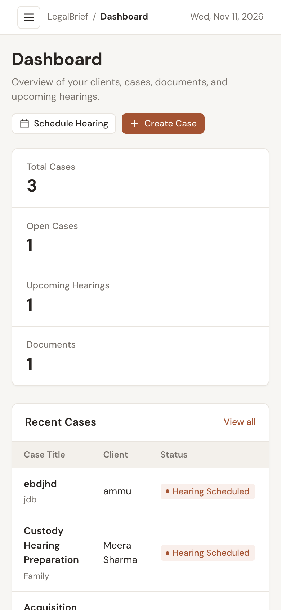

# LegalBrief — Legal Case Management SaaS Platform


A modern, full-stack LegalTech case management SaaS platform designed for law firms and legal practitioners. LegalBrief provides an organized command center to manage clients, legal matters, evidence documents, scheduled court hearings, and chronological activity timelines — secured with JWT authentication and role-based access control (RBAC).

---

## Visual Tour & Interface

### 1. Command Center Dashboard
An actionable high-density overview featuring key metrics, recent matters, and upcoming court dates.



---

### 2. Case Management & Docket
Searchable, filterable case directory with status tracking, practice area categorization, lawyer assignment, and multi-tab detail modals.



---

### 3. Client Directory
Comprehensive client relationship database tracking contact information, physical addresses, and representation notes.



---

### 4. Court Hearings & Proceedings Calendar
Interactive court hearing schedule with upcoming/past tab filters, automated reminders, and courtroom details.



---

### 5. Evidentiary Document Repository
Case-linked document repository supporting drag-and-drop file uploads, size restrictions, and direct access.



---

### 6. Case Activity & Audit Timeline
Continuous chronological audit trail tracking case events, notes, filed evidence, and counsel updates.



---

### 7. Clean Authentication & Mobile Responsiveness
Sleek 50/50 split authentication layout and fully responsive navigation drawer for phones and tablets.

| Secure Authentication | Mobile Experience (390px) |
|:---:|:---:|
|  |  |

---

## Core Capabilities

- **Role-Based Access Control (RBAC):** Admin and Lawyer tiers with protected routes and administrative access approval workflows.
- **Matter Management:** Create, filter, update, and manage litigation or advisory matters with full case status lifecycle.
- **Client Records:** Centralized directory with full search capabilities and linked cases.
- **Document Management:** Multi-format file uploader (PDF, Word, Images, Plain Text) with server validation and size constraints.
- **Court Schedule & Automated Reminders:** Tracks proceedings and sends automated reminder emails 48 hours prior to hearing dates via Nodemailer.
- **Chronological Case Timelines:** Immutable timestamped logs for counsel deposition notes, motions, and evidence filings.
- **Modern Editorial Aesthetic:** Thoughtfully styled interface built with a warm-neutral palette (`#F7F6F3`), deep espresso navigation, and clear typographic hierarchy.

---

## Tech Stack

### Frontend
- **Framework:** React 18
- **Build Tool:** Vite 5
- **Routing:** React Router DOM v6
- **HTTP Client:** Axios with JWT request & response interceptors
- **Styling:** Custom CSS design system (Zero heavy CSS frameworks)
- **Typography:** Playfair Display (Brand) & DM Sans (UI)

### Backend
- **Runtime:** Node.js
- **Server Framework:** Express.js
- **Database:** MongoDB Atlas via Mongoose
- **Authentication:** JWT (JSON Web Tokens) with HTTP Authorization headers
- **Password Hashing:** bcrypt (10 salt rounds)
- **File Upload Engine:** Multer
- **Scheduled Tasks:** node-cron (daily 8:00 AM reminder check)
- **Email Delivery:** Nodemailer (Gmail SMTP integration)
- **Rate Limiting:** express-rate-limit

---

## Project Structure

```text
LegalBrief/
├── backend/
│   ├── config/            # MongoDB connection configuration
│   ├── controllers/       # Business logic (Cases, Clients, Auth, Hearings, Docs)
│   ├── cron/              # Automated scheduled jobs (Hearing reminders)
│   ├── middleware/        # JWT auth, error handlers, and upload middleware
│   ├── models/            # Mongoose data schemas (User, Case, Client, etc.)
│   ├── routes/            # REST API route endpoints
│   ├── scripts/           # Seed and maintenance utilities
│   ├── utils/             # Email services & helpers
│   ├── uploads/           # Uploaded case document storage
│   ├── .env.example       # Backend environment template
│   ├── package.json
│   └── server.js          # Express app entry point
├── frontend/
│   ├── src/
│   │   ├── api/           # Axios instance & interceptors
│   │   ├── components/    # Reusable UI components (Modal, StatusBadge, etc.)
│   │   ├── context/       # Auth state management provider
│   │   ├── pages/         # Application view pages
│   │   ├── styles/        # Global CSS design tokens
│   │   ├── App.jsx        # Route definitions
│   │   └── main.jsx       # React DOM root
│   ├── .env.example       # Frontend environment template
│   ├── index.html
│   ├── package.json
│   └── vite.config.js
├── docs/
│   └── screenshots/       # High-resolution application screenshots
├── sample-test-data.json  # Reference mock data
├── LICENSE                # Proprietary license agreement
└── README.md
```

---

## REST API Reference

| Method | Endpoint | Description | Access |
|:---|:---|:---|:---|
| `POST` | `/api/auth/register` | Register a new user | Public |
| `POST` | `/api/auth/login` | Authenticate user & issue JWT | Public |
| `GET` | `/api/auth/profile` | Get current user profile | Authenticated |
| `GET` | `/api/dashboard/summary` | Get summary counts & recent cases | Authenticated |
| `GET` | `/api/clients` | List clients (supports `?keyword=`) | Authenticated |
| `POST` | `/api/clients` | Create a new client | Authenticated |
| `PUT` | `/api/clients/:id` | Update client details | Authenticated |
| `DELETE` | `/api/clients/:id` | Remove a client | Authenticated |
| `GET` | `/api/cases` | List cases (`?keyword=`, `?status=`) | Authenticated |
| `POST` | `/api/cases` | Create a legal case | Authenticated |
| `GET` | `/api/cases/:id` | Get case detail with hearings & docs | Authenticated |
| `PUT` | `/api/cases/:id` | Update case status or information | Authenticated |
| `DELETE` | `/api/cases/:id` | Delete case and associated files | Authenticated |
| `GET` | `/api/documents` | List documents by case ID | Authenticated |
| `POST` | `/api/documents/upload` | Upload evidence document via Multer | Authenticated |
| `DELETE` | `/api/documents/:id` | Delete document | Authenticated |
| `GET` | `/api/hearings` | List scheduled hearings | Authenticated |
| `POST` | `/api/hearings` | Schedule a court hearing | Authenticated |
| `PUT` | `/api/hearings/:id` | Reschedule or update hearing | Authenticated |
| `DELETE` | `/api/hearings/:id` | Remove hearing | Authenticated |
| `GET` | `/api/timelines/:caseId`| Fetch case chronological activity | Authenticated |
| `POST` | `/api/timelines` | Add manual activity/deposition note | Authenticated |
| `GET` | `/api/admin-requests` | View pending admin role requests | Admin |
| `PATCH`| `/api/admin-requests/:id/approve` | Approve promotion to Admin | Admin |
| `PATCH`| `/api/admin-requests/:id/reject` | Reject promotion request | Admin |

---

## Local Setup & Installation

### Prerequisites
- Node.js (v18 or higher)
- npm or yarn
- MongoDB Atlas account or local MongoDB instance

### 1. Clone the Repository
```bash
git clone https://github.com/Amit-Shukla07/LegalBrief.git
cd LegalBrief
```

### 2. Backend Configuration
```bash
cd backend
npm install
cp .env.example .env
```

Configure your `backend/.env` file:
```env
PORT=5001
MONGO_URI=your_mongodb_connection_string
JWT_SECRET=your_jwt_secret_key
JWT_EXPIRES_IN=7d
CLIENT_URL=http://localhost:5173
EMAIL_USER=your_email@gmail.com
EMAIL_PASS=your_gmail_app_password
```

Start the backend server:
```bash
npm run dev
```

### 3. Frontend Configuration
In a new terminal window:
```bash
cd ../frontend
npm install
cp .env.example .env
```

Configure `frontend/.env`:
```env
VITE_API_URL=http://localhost:5001/api
VITE_SERVER_URL=http://localhost:5001
```

Start the Vite development server:
```bash
npm run dev
```

Visit **`http://localhost:5173`** to access LegalBrief.

---

## License

Copyright (c) 2026 Amit Shukla. All rights reserved.

This software, source code, and assets are proprietary. Unauthorized copying, distribution, modification, or commercial use is strictly prohibited. Refer to the [LICENSE](LICENSE) file for complete terms.

---

## Author

- **Amit Shukla** — [GitHub Profile](https://github.com/Amit-Shukla07)
